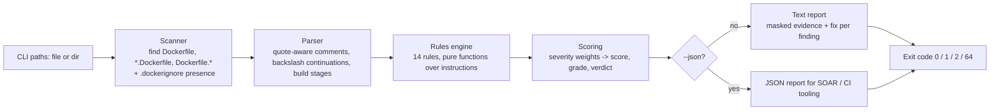

# dockseal 🦭

**Zero-dependency Dockerfile security auditor.** One pure-stdlib command checks a Dockerfile for the mistakes that turn a container into an incident: secrets baked into layers, root-privileged final stages, unpinned or `:latest` base images, remote scripts piped into shells, and the host Docker socket. Exit codes double as a CI gate, so a PR that ships a credential file never reaches `main`.


---

## Why dockseal exists

2026 has been the year container build files stopped being boring:

- **March 2026 — Trivy supply-chain attack:** the compromised pipeline pushed *malicious images to Docker Hub*, and developers who trusted a familiar tag got an infostealer. The lesson for *consumers* of images is the same lesson for *producers*: tags are mutable, builds are attack surface.
- **April 2026 — Checkmarx KICS images backdoored:** the "official" repository itself served trojanized images — credentials harvested from build environments.
- **Every year — the base image quietly changed:** `FROM python:latest` resolves to a different image every time upstream decides, and your Dockerfile diff is empty.

Runtime image scanners (Trivy, Grype) tell you what is *inside* the image you already built. dockseal tells you **what is wrong with the Dockerfile itself, before you build it** — in one command that runs anywhere Python runs, including locked-down CI runners where you cannot install a Haskell or Go binary (looking at you, hadolint).

| Tool         | Language | Install            | Focus                                  |
|--------------|----------|--------------------|----------------------------------------|
| hadolint    | Haskell  | system binary      | general linting + shellcheck           |
| dockerfilelint | Go     | system binary      | style linter (aging)                   |
| **dockseal** | **Python 3.9+** | **`pip install`** | **security rules tied to incident classes, CI gate, secret masking** |

## Installation

```bash
# from source (this repo)
pip install .

# both invocation styles work with zero dependencies:
dockseal Dockerfile                      # console script
python -m dockseal Dockerfile            # module form
```

`dockseal` runs on the standard library alone (`re`, `argparse`, `json`, `os`, `dataclasses`). Verifiably: `requirements.txt` is empty and CI installs the package into a bare venv.

## Quick start

```bash
dockseal Dockerfile              # one file
dockseal deploy/ services/       # directories: finds Dockerfile, *.Dockerfile, Dockerfile.*
dockseal --json .                # machine-readable report
dockseal --min-grade B Dockerfile   # CI gate: grade below B -> exit 2
```

### Sample output (real run, from `examples/Dockerfile.vulnerable`)

```text
Dockseal - Dockerfile security audit
============================================================
Target   : examples/Dockerfile.vulnerable
Verdict  : BLOCK   Score: 205   Grade: F
Findings : 14  (critical: 5)
============================================================

[CRITICAL] DS-003: Secret-looking literal in ENV (`OPENAI_API_KEY`)
  Where  : line 8  (weight 25)
  Code   : ENV OPENAI_API_KEY=sk-0...<masked>
  Fix    : Never bake secrets into images - they live in every layer, even if a
           later line removes them. Use runtime secrets (env injection, secret mounts).

[CRITICAL] DS-009: Sensitive file copied into the image
  Where  : line 14  (weight 25)
  Code   : COPY server.key /app/server.key
  Fix    : Key/credential files end up in image layers and in Docker Hub. Remove
           the COPY, mount secrets at runtime, and add the file to .dockerignore.

[HIGH] DS-006: Final stage never switches away from root
  Where  : file-level  (weight 15)
  Fix    : Add a dedicated user and switch to it: RUN useradd -r app && USER app...

[HIGH] DS-001: Unpinned base image (`:latest`)
  Where  : line 5  (weight 15)
  Code   : FROM python:latest
  Fix    : Pin a specific version tag and ideally a sha256 digest ...
```

and the audit-clean reference (`examples/Dockerfile.hardened`):

```text
Target   : examples/Dockerfile.hardened
Verdict  : PASS   Score: 0   Grade: A+
Findings : 0  (critical: 0)
```

## The rules

| ID      | Severity | Weight | Finding | The incident class it stops |
|---------|----------|--------|---------|------------------------------|
| DS-001  | HIGH     | 15 | Base image unpinned / `:latest` | tag drift silently swaps your base for something else |
| DS-002  | MEDIUM   | 8  | Base pinned by mutable tag only (no sha256 digest) | upstream re-pointing attacks (Trivy-on-Docker-Hub class) |
| DS-003  | CRITICAL | 25 | Literal secret in `ENV` / `ARG` | secrets persist in every layer and in `docker history` forever |
| DS-004  | CRITICAL | 25 | Raw key/token material in `RUN` | same, plus it lands in build logs and CI output |
| DS-005  | HIGH     | 15 | `curl \| bash` remote installer runs at build time | executes whatever the server returns, when it returns it |
| DS-006  | HIGH     | 15 | Final stage runs as root | container escape == host root |
| DS-007  | LOW      | 3  | `ADD` where `COPY` would do | `ADD` magic: silently untars archives, fetches URLs |
| DS-008  | MEDIUM   | 8  | No `.dockerignore` in the build context (directory audits) | `.git`, `.env`, `id_rsa` flow into the daemon and any `COPY .` layer |
| DS-009  | CRITICAL | 25 | Credential file copied in (`id_rsa`, `.env`, `*.pem`, …) | keys shipped to the registry next to your app |
| DS-010  | HIGH     | 15 | Host Docker socket referenced | whoever runs the container owns the host daemon |
| DS-011  | MEDIUM   | 8  | `sudo` inside a build | pointless in root builds; adds packages + log noise |
| DS-012  | LOW      | 3  | `chmod 777`-style world-writable grants | any process in the container can tamper with these paths |
| DS-013  | LOW      | 3  | `apt-get` that leaves package lists behind | bloat + stale mirrors (hygiene, not danger) |
| DS-014  | LOW      | 3  | `EXPOSE` without `HEALTHCHECK` | orchestrators cannot tell a live service from a zombie |

### Scoring, grades, verdicts

- **Score** = sum of finding weights. **Grades:** `A+` (0), `A` (≤3), `B` (≤8), `C` (≤15), `D` (≤30), `F` (more).
- **Verdict** = `PASS` (score 0) / `WARN` (findings, all minor) / `BLOCK` (any CRITICAL or score ≥ 50).
- **Secrets are always masked** in output and JSON: a 4-character prefix plus `<masked>`, so findings stay recognizable while reports and logs stay safe to paste. The test suite asserts the raw values never appear in output.

### Exit codes (the CI contract)

| Code | Meaning |
|------|---------|
| 0    | PASS — no findings |
| 1    | WARN — findings, none blocking |
| 2    | BLOCK — critical finding, score ≥ 50, or grade below `--min-grade` |
| 64   | usage error: unreadable path, or no Dockerfile anywhere in the given directories |

## Architecture



```
dockseal/
├── src/dockseal/
│   ├── parser.py   # Dockerfile -> Instruction[] (continuations, stages, line numbers)
│   ├── rules.py    # 14 findings, each mapped to a real incident class
│   ├── report.py   # scoring, grades, verdicts, text/JSON renderers, masking
│   └── cli.py      # argparse, path scanning, exit codes
├── tests/          # 40 tests: parser, every rule, end-to-end CLI, JSON, gating
└── examples/
    ├── Dockerfile.vulnerable   # trips every rule -> BLOCK (score 205)
    ├── Dockerfile.hardened     # audit-clean reference -> PASS (score 0)
    └── .dockerignore           # the context hygiene dockseal checks for
```

Design notes:

- **Line-accurate findings.** The parser tracks physical line numbers across backslash continuations so every finding points at the exact line to edit.
- **Stage-aware `USER` analysis.** `DS-006` only judges the *final* stage — a root `builder` stage that hands off to a non-root runtime image is the correct, standard multi-stage pattern.
- **Heuristic secret detection, deliberately.** dockseal does not try to be a vault scanner; it catches the high-confidence shapes (key prefixes, JWTs, private-key headers, secret-sounding names with long literal values) and stays quiet on `${PLACEHOLDER}` references, which are the *right* way to parameterize builds.
- **Zero network calls.** Pure static analysis: runs on a locked-down runner, emits nothing.

## Use cases

1. **PR gate for container changes** — run `dockseal --min-grade B` in CI; a Dockerfile edit that bakes a token or drops the `USER` line fails the build before merge.
2. **Pre-commit hook** — `dockseal Dockerfile` takes milliseconds and needs no binaries; write the habit before the registry.
3. **Monorepo sweeps** — `dockseal services/ ops/` audits every service's Dockerfile in one command (skips `.git`, `node_modules`, vendored trees).
4. **Registry publishing checks** — before `docker push`, block credential-file COPYs and `FROM :latest` so what ships to Docker Hub is what you reviewed.
5. **Security-review triage** — the JSON report (`--json`) gives reviewers a structured finding list with severities, lines and fixes, importable into ticketing or SOAR tooling.
6. **Onboarding guardrail** — new contributors copy-paste Dockerfiles from blog posts; dockseal explains *why* each pattern is dangerous, with the fix inline.
7. **Teaching / CTF labs** — the bundled `Dockerfile.vulnerable`/`Dockerfile.hardened` pair demonstrates every rule firing and a clean multi-stage build, diffable line by line.

## CI example

```yaml
# .github/workflows/dockseal.yml
name: dockerfile-audit
on: [pull_request]
jobs:
  audit:
    runs-on: ubuntu-latest
    steps:
      - uses: actions/checkout@v4
      - uses: actions/setup-python@v5
        with: { python-version: "3.12" }
      - run: pip install .
      - run: dockseal --min-grade B .
```

## Honesty section (limits)

- dockseal is a **static heuristic audit of Dockerfile text**. It cannot see inside built images, your runtime configuration, your orchestrator manifests, or base images you did not write. Use it *with* a runtime image scanner, not instead of one.
- The parser is a **pragmatic subset**: line continuations, comments, multi-stage builds and the standard instruction set. Exotic syntax (rare HEREDOC forms, buildkit `--mount` semantics) is parsed as plain text; findings may occasionally be less precise there.
- Secret detection is high-precision, not high-recall: it targets known credential shapes and secret-sounding **literal** values. Obfuscated or novel secret shapes will pass. It is a smoke test, not a proof of safety — and `PASS` here does not certify your image.
- Severity weights are **opinionated but documented**; tune them by editing one table in `rules.py` if your threat model differs.
- Auditing a lone file cannot know whether a `.dockerignore` exists elsewhere in context; `DS-008` therefore only fires on directory audits (by design, never as a false positive).

## Testing

```bash
PYTHONPATH=src python -m unittest discover -s tests -v   # 40/40 passing
```

The suite covers the parser (continuations, comments, stages, line numbers), every rule (trigger + clean case + masking guarantees) and end-to-end CLI behavior (verdicts, JSON shape, grade gating, directory scanning, exit codes). It also asserts the vulnerable example trips **every** rule and the hardened example scores a clean **0** — a regression contract for the whole rule catalog.

## License

MIT — see [LICENSE](LICENSE).
